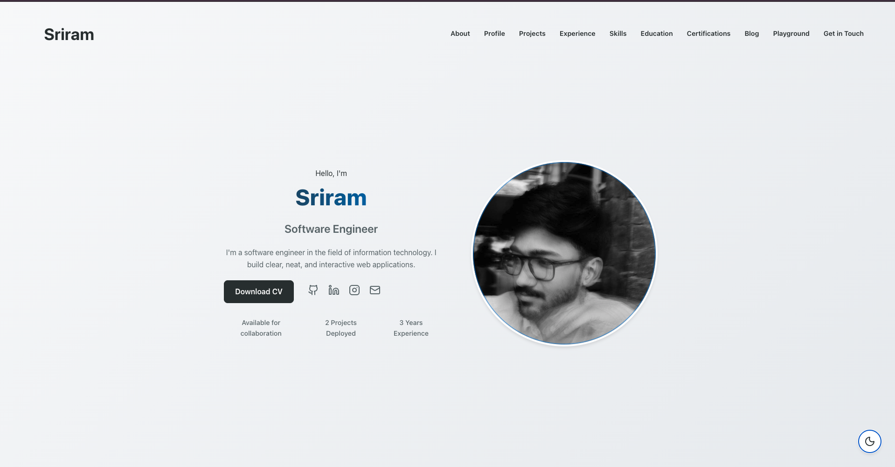

# Personal Portfolio
A clean, fast and responsive personal portfolio website built with React, Vite, and modern CSS. Showcases my skills, projects, experience, education, certifications and more - all in a visually appealing and interactive interface



## 🚀 Features

-   **Modern UI/UX**: Clean design with glassmorphism effects, bento grid layouts, and smooth transitions.
-   **Responsive Design**: Fully optimized for all devices (Mobile, Tablet, Desktop).
-   **Dark/Light Mode**: Seamless theme switching with persistent preference.
-   **Interactive Elements**:
    -   **Introduction**: Eye-catching introduction with stats.
    -   **Short Profile**: Bento grid layout showcasing skills, hobbies, and facts.
    -   **Timeline**: Vertical timeline for Experience and Education with logos and tech stacks.
    -   **Skills**: Tabbed interface with interactive flip cards.
    -   **Projects**: Showcase with hover effects and links.
    -   **Certifications**: Card-based credential display with direct verification links.
    -   **Blog**: Magazine-style recent posts section.
    -   **Labs**: A fun section for quotes and other interactive widgets.
-   **Contact Form**: Integrated contact section.

## 🛠️ Tech Stack

-   **Frontend Framework**: [React](https://reactjs.org/) (v18+)
-   **Build Tool**: [Vite](https://vitejs.dev/)
-   **Styling**: Vanilla CSS (Variables, Flexbox, Grid, Glassmorphism)
-   **Icons**: [Lucide React](https://lucide.dev/) & [React Icons](https://react-icons.github.io/react-icons/)
-   **Linting**: ESLint

## 📦 Installation

1.  **Clone the repository**
    ```bash
    git clone https://github.com/Sriram-5602/portfolio.git
    cd portfolio
    ```

2.  **Install dependencies**
    ```bash
    npm install
    ```

3.  **Start the development server**
    ```bash
    npm run dev
    ```

4.  **Build for production**
    ```bash
    npm run build
    ```

## 📂 Project Structure

```
src/
├── components/         # Reusable UI components
│   ├── Header.jsx      # Navigation bar
│   ├── Hero.jsx        # Landing section
│   ├── ShortProfile.jsx# Bento grid profile
│   ├── Projects.jsx    # Project showcase
│   ├── Timeline.jsx    # Experience & Education
│   ├── Skills.jsx      # Interactive skills section
│   ├── Certifications.jsx # Certifications list
│   ├── Blog.jsx        # Recent blog posts
│   ├── FunSection.jsx  # Labs
│   ├── Contact.jsx     # Contact form
│   └── ...
├── data/
│   └── portfolio.js    # Centralized data file (Edit this to update content!)
├── App.jsx             # Main application component
├── App.css             # Global styles
└── index.css           # Theme variables and resets
```

## 🎨 Customization

All content is managed via a single data file for easy updates.

1.  Open `src/data/portfolio.js`.
2.  Update the `personalInfo`, `projects`, `experience`, `skills`, etc., with your own details.
3.  Replace placeholder images with your own URLs.

## 📦 Deployment

This project is optimized for modern hosting platforms like :
-   GitHub Pages
-   Netlify
-   Vercel

Example deployment (Vercel) :
-   Push the project to GitHub repository.
-   Create a new Vercel project and connect it to the GitHub repository.
-   Deploy the project.

## 🤝 Contributing

Contributions are welcome! If you'd like to improve this project:

1.  Fork the repo.
2.  Create a new branch (`git checkout -b feature/YourFeature`).
3.  Commit your changes (`git commit -m 'Add some feature'`).
4.  Push to the branch (`git push origin feature/YourFeature`).
5.  Open a Pull Request.

## 📄 License

This project is licensed under the MIT License

---

Made with ❤️ by [Sriram](https://github.com/Sriram-5602)